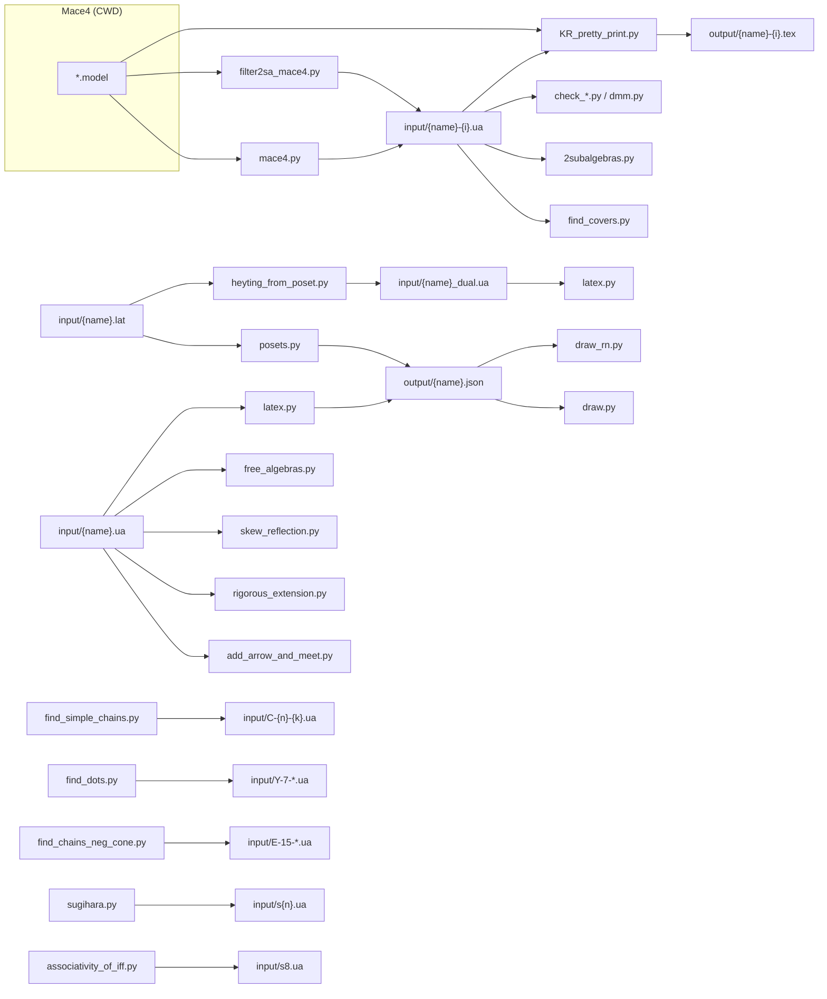

# Jamie PhD Jython scripts — I/O map

Source scripts live read-only under `C:\Users\u28409265\Documents\uacalc` (~39 top-level `.py` files). Most assume the **script directory is the current working directory** (Jamie’s Syncthing folder), with sibling folders `input/`, `output/`, and Mace4 `*.model` files at the **top level** (not under `input/`).

Test fixtures mirroring that layout: [`tests/jython_scripts/phd/fixtures/`](../tests/jython_scripts/phd/fixtures/) (see [`manifest.json`](../tests/jython_scripts/phd/fixtures/manifest.json)).

## LatDraw dependency (`.lat` files)

Jamie's `.lat` poset files are the LatDraw text format (see [latdraw.org](http://www.latdraw.org/doc/)). Only **`posets.py`** imports LatDraw directly:

| API (Jython) | Use |
|----------------|-----|
| `org.latdraw.orderedset.InputLattice` | Parse a `.lat` file path (`name`, `labels`, `upperCoversList`) |
| `org.latdraw.orderedset.OrderedSet.orderedSetFromFilters` | Build poset from filters; also used via `posets.dict2poset` |
| `OrderedSet` element methods (`filter`, `label`, …) | Upset lattice in `get_upsets_lattice`; graph export via `latex.get_graph_from_poset` |

**`heyting_from_poset.py`** does not import `org.latdraw`; it calls `posets.InputPoset` and therefore needs the same classpath.

**In this repo**

- **`jars/LatDraw.jar`** is vendored and used by parity tooling (e.g. `tools/generate_golden_data.py`, `tests/parity/io/generate_special_algebra_fixtures.py`). It is **not** bundled next to the PhD scripts under `tests/jython_scripts/phd/`; the porting harness should add `jars/LatDraw.jar` (and `uacalc.jar`) like Jamie's `sys.path.append("LatDraw.jar")`.
- **`org.latdraw.*` is not part of `org.uacalc`**; the Java sources in-tree only *reference* latdraw from UI code (`org.uacalc.ui.LatDrawer`, `LatDrawPanel`, etc.). `parity_inventory.yaml` tracks **`org.uacalc`** packages, not `org.latdraw`.
- **`org.uacalc` Python wrapper (CPython):** `org.uacalc.lat.OrderedSet.from_filters(...)` in `uacalc_lib` covers **filter lists**, not `.lat` file parsing. There is **no** `InputLattice` or `.lat` reader in the wrapper today. Parity tests use `org.latdraw.orderedset.OrderedSet` on Jython and `OrderedSet.from_filters` on CPython for the same mathematical input (`tests/parity/lat/test_cases/lattices_cases.py`, case `ordered_set_from_filters`).
- **Porting implication:** to run `posets.py` / `heyting_from_poset.py` unchanged on Jython, keep **LatDraw.jar** on the classpath. To run on CPython without Java, something must either parse `.lat` into filter lists and call `OrderedSet.from_filters`, or expose a small `.lat` parser shim.

## Path layout (two conventions)

| Convention | Scripts | Reads | Writes |
|------------|---------|-------|--------|
| **A — relative `input/` / `output/`** (no `chdir`) | `posets`, `heyting_from_poset`, `check_*`, `add_arrow_and_meet`, `dmm`, `latex`, `skew_reflection`, `sums`, `structural_completeness`, `associativity_of_iff` | `input/{name}.ua` or `input/{name}.lat` | `input/*`, `output/*.json`, `output/*.tex` |
| **B — `dir_path = dirname(__file__)` + `os.chdir(dir_path)`** | `mace4`, `filter2sa_mace4`, `rigorous_extension`, `find_*`, `2subalgebras`, `draw_chains`, `jep_check`, `sugihara`, `get_subreducts`, `free_algebras` | `os.path.join(dir_path,'input', …)` | Same under `dir_path` |
| **Mace4 models at repo root** | `mace4`, `filter2sa_mace4`, `KR_pretty_print` | `{argv[1]}.model` or `{argv[1]}.modelall` in **CWD** (script root) | `input/{name}-{i}.ua` and/or `output/{name}-{i}.tex` |

**Obsolete / fragile paths**

- `get_idempotents.py`: `sys.path.append("C:/Users/Vincent/Programming/UACalc_CLI/CLI/Jars/uacalc.jar")` — replace with local `uacalc.jar` like other scripts.
- `free_algebras.py`: TeX path `os.path.join('uacalc', out_dir, name)` — assumes a parent `uacalc/` tree for `\input{...}`; live data is under `output/`.
- Many scripts append `uacalc.jar` and `LatDraw.jar` next to the scripts (present in Jamie’s folder; not in this repo).

## `.lat` files (posets, Heyting, drawing)

All **35** LatDraw poset files are in `uacalc/input/*.lat` (total ~1.2 KB). Names are the `argv[1]` stem:

| Script | How it resolves inputs | Outputs | Downstream |
|--------|------------------------|---------|------------|
| [`posets.py`](file:///C:/Users/u28409265/Documents/uacalc/posets.py) | `input/{argv[1]}.lat` via `InputLattice` / `OrderedSet` | `output/{name}.json`; shells `python draw.py {json}` → PDF | `draw.py`, optional `draw_rn.py` for RN-style graphs |
| [`heyting_from_poset.py`](file:///C:/Users/u28409265/Documents/uacalc/heyting_from_poset.py) | Same `input/{argv[1]}.lat` | `input/{name}_dual.ua` | `latex.py`, `check_heyting.py`, manual checks |
| [`draw_rn.py`](file:///C:/Users/u28409265/Documents/uacalc/draw_rn.py) | **`sys.argv[1]` = path to an existing `.json`** (not `.lat` / `.model`) | `{json_stem}.dot`, `{json_stem}.pdf` | Used from commented loop in `riger_nishinora.py` on `output/{RN-*}.json` |

**Test harness:** set CWD to the fixture root so `input/RN-0.lat` exists; run `posets.py RN-0`, then `draw_rn.py output/RN-0.json`. For Heyting-only tests, `heyting_from_poset.py d3` (small poset file).

RN series: `RN-0.lat` … `RN-10-9.lat`, plus `R6.lat`, `R6D.lat`, `G2_plus_Lg4.lat`, `Lg4.lat`, `d3.lat`, `k3.lat`, `D-3.lat`, `X-2.lat`, `na5.lat`, etc. (full list in manifest).

## Per-script summary

Role legend: **G** generator, **F** filter, **A** analysis/check, **D** draw/visualization, **U** utility/library, **H** skip in CI (huge/network).

| Script | Role | Reads | Writes | Limit / argv | Deps | Path status |
|--------|------|-------|--------|--------------|------|-------------|
| `2subalgebras.py` | F/A | `input/{glob argv[1]}` | *(intended)* `output/{base}covers.tex` — **file ends before write** | Glob pattern e.g. `C-5-*.ua` | `dmm`, `latex`, Jython `uacalc`/`LatDraw` | OK; incomplete script |
| `add_arrow_and_meet.py` | G | `input/{name}.ua` | Overwrites same `.ua` | `argv[1]` name | `dmm` | OK |
| `associativity_of_iff.py` | G/A | `input/b2.ua`, `input/s3.ua`; builds Sugihara 8 in memory | `input/s8.ua` | Hardcoded algebras in `__main__` | `dmm`, `sugihara` | OK |
| `check_andrew.py` | A | `input/{name}.ua` | stdout | `argv[1]` | `dmm` | OK |
| `check_crl.py` | A | `input/{name}.ua` | stdout | `argv[1]` | `dmm` | OK |
| `check_dunn.py` | A | `input/{name}.ua` | stdout | `argv[1]` | `dmm` | OK |
| `check_heyting.py` | A | `input/{name}.ua` | stdout | `argv[1]` | `dmm` | OK |
| `check_m.py` | A | `input/{name}.ua` | stdout | `argv[1]` | `dmm` | OK |
| `dmm.py` | G/A | `input/{name}.ua` | Overwrites `.ua` if ops added | `argv[1]` | `dmm`, `pyparsing`, Jython | OK |
| `draw.py` | D | `argv[1]` `.json` | `.dot`, `.pdf` beside JSON | JSON path | `pygraphviz`, Graphviz | Needs Graphviz |
| `draw_chains.py` | D | `input/C-7-*.ua` | `output/SevenElementSimples.tex` | No argv; fixed glob | `dmm`, `latex`, Jython | Needs many `C-7-*` |
| `draw_rn.py` | D | `argv[1]` `.json` | `.dot`, `.pdf` | JSON path | `pygraphviz`, `networkx`, `matplotlib`, Graphviz | OK with fixture JSON |
| `ez_setup.py` | U | — | — | setuptools bootstrap | — | Not applicable |
| `filter2sa_mace4.py` | F | `{name}.model` or `.modelall` (CWD); filters via `SubalgebraLattice` | `input/{name}-{i}.ua` if ≤2 subalgs | `argv[1]` | `mace4` parser, `pyparsing`, Jython | OK; use `KR-1gen.model` |
| `find_chains_neg_cone.py` | G **H** | `input/b2xs3_reflection.ua`; enumerates dots | `input/E-{card}-{id}.ua` | **Hardcoded card 15**; `-pn` threads | `dmm`, Jython | Huge search |
| `find_covers.py` | D **H** | `input/S-*-*.ua` | `output/ManyCoversOfC4New.tex` | No argv | `latex`, Jython | Huge `S-*` corpus |
| `find_dots.py` | G **H** | Enumerates internally | `input/Y-7-*.ua` | **Hardcoded card 7** | `dmm`, Jython | Huge search |
| `find_simple_chains.py` | G **H** | Enumerates | `input/C-{n}-{k}.ua` | `argv`: min/max card, `-pn` | `dmm`, Jython | Default 5–5 in help; exponential |
| `find_simple_chains_powers.py` | D **H** | `input/simple_chains_power5_*-*.ua` | `output/ManyPowers5.tex` | Fixed glob | `latex`, Jython | Needs generated power5 set |
| `free_algebras.py` | G | `input/{name}.ua` | `input/{name}_F1.ua`, `output/{name}_subalgebra.tex` | `argv[1]` | Jython, `isomorphism` | Obsolete `uacalc/` tex path |
| `get_idempotents.py` | A **H** | Fixed: `c4`, `c4_weaved`, `s3_weaved`, `s3_reflection` | stdout | No argv; scans `FreeAlgebra` | Jython; **wrong jar path** | Fix jar path |
| `get_subreducts.py` | F | stdin or `-f` Mace4/model stream | stdout (counts) | `argv[1]` signature terms; `-f file` | `mace4.to_alg_stream` | `group.in` at repo root |
| `heyting_from_poset.py` | G | `input/{name}.lat` | `input/{name}_dual.ua` | `argv[1]` = lat stem | `posets`, `dmm`, LatDraw | OK |
| `isomorphism.py` | U | — (library) | — | — | Jython | OK |
| `jep_check.py` | A **H** | Hardcoded cover lists + `glob input/C-*-*.ua` | stdout | No argv | `isomorphism`, Jython | Heavy combinatorics |
| `KR_pretty_print.py` | D | `{name}.model` (CWD) | `output/{name}-{i}.tex` | `argv[1]` | `numpy`, `powerset`, `pyparsing` | OK |
| `latex.py` | D | `input/{name}.ua` | `output/{name}.json`, `.tex`; calls `draw.py` | Optional label args | `dmm`, Graphviz | OK |
| `mace4.py` | G | `{name}.model` (CWD) | `input/{name}-{i}.ua` | `argv[1]` | `pyparsing`, Jython | OK |
| `posets.py` | D | `input/{name}.lat` | `output/{name}.json`; `draw.py` | `argv[1]` | `dmm`, `latex`, LatDraw | OK |
| `powerset.py` | U | — | stdout (Mace4 clauses) | `argv[1]` = generator count | `numpy` (optional checks) | OK |
| `riger_nishinora.py` | D/U | *(active code only prints)*; commented: `.lat` → json/ua/tex | `RN.tex` when enabled | Commented `limit=5` | `posets`, `heyting_from_poset`, `draw_rn` | Generation disabled |
| `rigorous_extension.py` | G | `input/{name}.ua` | `input/{name}_re.ua` | `argv[1]` | Jython | OK |
| `sc_joins_of_covers.py` | A **H** | Fixed list in `input/*.ua` | stdout | No argv | `skew_reflection`, Jython | OK |
| `search_c4.py` | U **H** | DBpedia SPARQL | stdout XML | Network | `SPARQLWrapper` | Skip offline |
| `skew_reflection.py` | G | `input/{name}.ua` | `input/{name}_{reflection\|weaved\|skew}.ua` | `argv[2]` mode | `dmm` | OK |
| `structural_completeness.py` | A | Hardcoded `input/c4_weaved.ua` | stdout | No argv | Jython | OK |
| `sugihara.py` | G | — | `input/s{n}.ua` or `sa{n}.ua` | `n`, optional `monoid`/`algebra` | `dmm` | OK |
| `sums.py` | A | Hardcoded `Br2.ua`, `A_brouwerian.ua`, `Br2xBr2.ua` | *(commented write)* | No argv | `dmm` | OK |
| `twist.py` | U | — | stdout | — | — | OK |
| `dmm.py` (library) | U | Used by almost all | — | — | `pyparsing`, Jython | Central API |

## Producer → consumer chains

## Fixture set (committed)

| Category | Files | Source |
|----------|-------|--------|
| All `.lat` posets (35) | `fixtures/input/*.lat` | `uacalc/input/` |
| Representative `.ua` | `b2`, `s3`, `c4`, `c4_weaved`, `Br2`, `A_brouwerian`, `b2xs3_reflection`, `C-5-1`, `C-7-1`, `s3_reflection`, `s3_weaved`, `KR-1gen-1` | `uacalc/input/` |
| Mace4 models | `KR-1gen.model`, `t3.model` | `uacalc/` (top level) |
| Prover9 stream | `group.in` | `uacalc/group.in` |
| Graph JSON | `output/RN-0.json`, `RN-2.json` | `uacalc/output/` |

**Total size:** ~35 KB (52 files). **Remap for tests:** run with `cwd = tests/jython_scripts/phd/fixtures` so relative `input/`, `output/`, and `*.model` match Jamie’s layout.

## Unclear / follow-up for porting agent

1. `2subalgebras.py` appears truncated (no TeX write loop).
2. `find_dots.py` / `find_chains_neg_cone.py` ignore positional cardinality in favor of hardcoded constants.
3. `draw_rn.py` vs probes using `.model` — correct CLI is a **JSON path** produced by `posets.py` / `latex.py`.
4. Whether `heyting_from_poset` should write to `output/` instead of `input/` (current behavior overwrites input tree).
5. `LatDraw.jar` / `org.latdraw.*` required for `posets.py` and `.lat` parsing — ensure Jython classpath in harness matches Jamie’s layout.